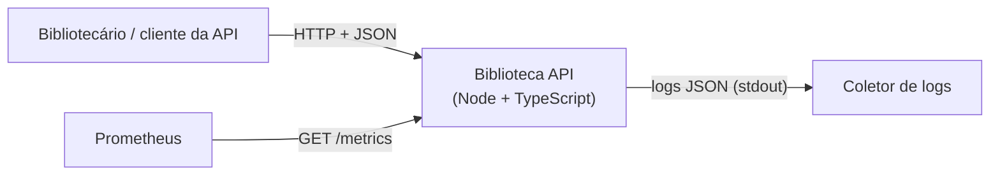

# C4 – Nível 1: Contexto

- **Biblioteca API**: único sistema. Expõe livros e empréstimos, documentação em `/docs` (Swagger UI) e contrato em `/openapi.json`.
- **Persistência**: em memória (ver [ADR 0001](../adr/0001-decisao.md)).
- **Observabilidade**: logs estruturados (pino) e métricas (prom-client) em `/metrics`.
